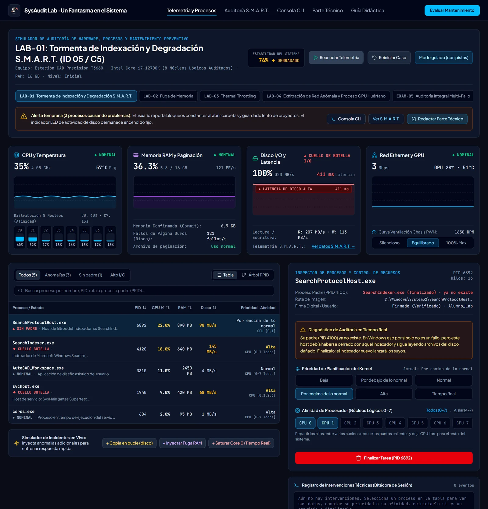
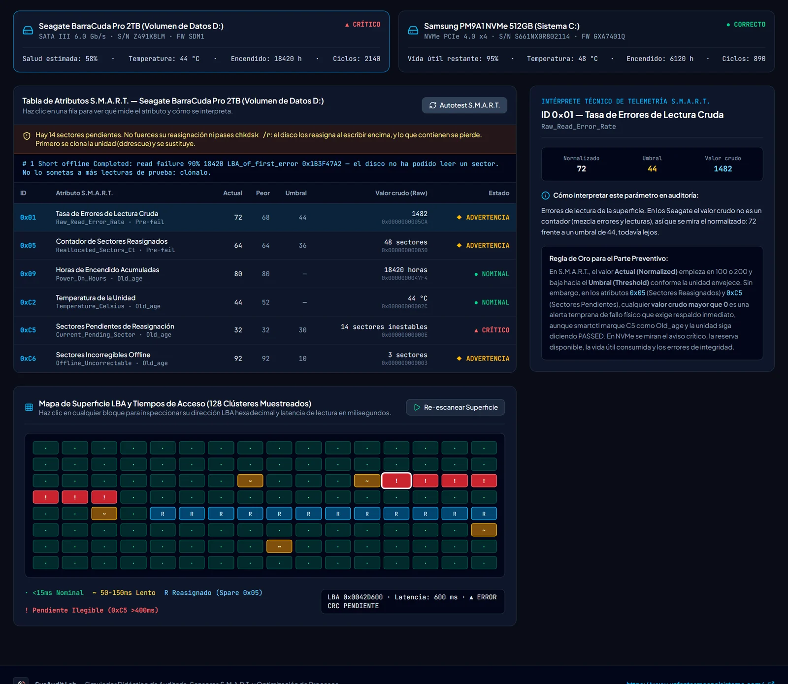
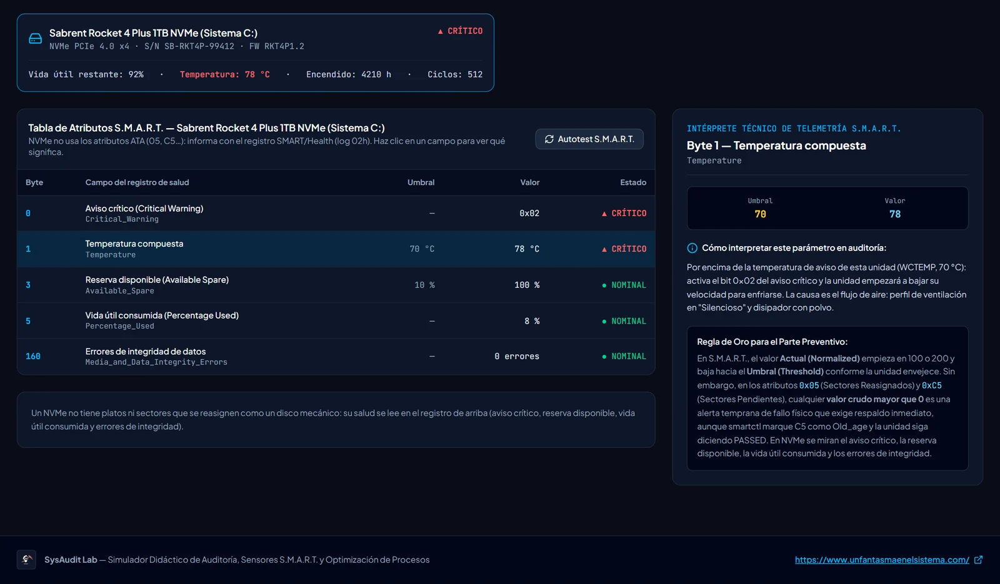
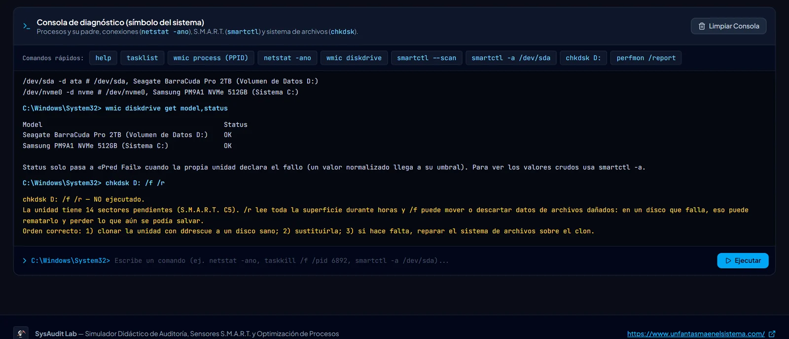
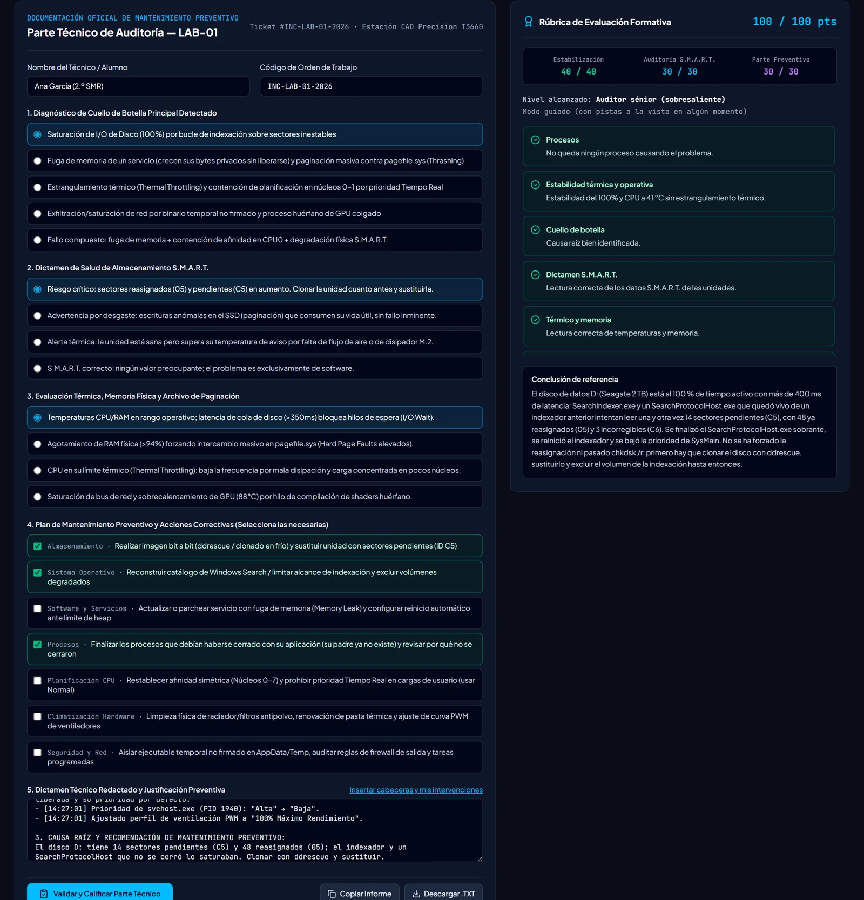

<p align="center">
  <a href="https://www.unfantasmaenelsistema.com"></a>
</p>

<h1 align="center">SysAudit Lab</h1>

<p align="center">
  <b>Audita un equipo lento: telemetría, procesos, S.M.A.R.T. de discos y SSD, consola y parte técnico evaluado</b><br>
  CPU, RAM, disco, red y GPU en vivo · Prioridad y afinidad · HDD (ATA) y NVMe · 5 casos y un examen · Modo guiado y modo examen
</p>

<p align="center">
  <a href="https://unfantasmaenelsistema.github.io/SysAuditLab-Analizador-Auditoria-SMART-Rendimiento/"><b>▶ Abrir el laboratorio</b></a> ·
  <a href="#qué-hace">Qué hace</a> ·
  <a href="#los-casos">Los casos</a> ·
  <a href="#smart-en-hdd-y-en-nvme">S.M.A.R.T. en HDD y en NVMe</a> ·
  <a href="#cómo-se-evalúa">Cómo se evalúa</a> ·
  <a href="#desarrollo">Desarrollo</a> ·
  <a href="https://www.unfantasmaenelsistema.com">unfantasmaenelsistema.com</a> ·
  <a href="LICENSE">MIT</a>
</p>

<p align="center">
  
  
  
  
</p>

<p align="center">
  
</p>

Un laboratorio de mantenimiento preventivo para clase. Cada caso es un equipo que va lento por una causa concreta: un disco con sectores pendientes, una fuga de memoria que obliga a paginar, un proceso en prioridad Tiempo Real encerrado en dos núcleos, un binario sin firma que satura la red… Hay que mirar la telemetría, encontrar los procesos responsables y tratarlos como corresponde (finalizar, reiniciar un servicio o corregir prioridad y afinidad), leer el S.M.A.R.T. de las unidades y redactar el parte técnico, que se evalúa sobre 100.

> [!NOTE]
> Todo funciona en el navegador, sin servidor. Solo se guarda en el `localStorage` la mejor nota de primer intento de cada caso.

## Qué hace

- **Telemetría en vivo**: uso y temperatura de la CPU por núcleo y su frecuencia, memoria y errores de página, tiempo activo y latencia del disco, red, GPU y estabilidad del equipo. La ventilación del chasis (silenciosa, equilibrada o al máximo) cambia las temperaturas de la CPU y de las unidades.
- **Procesos**: PID, padre (PPID), ruta, firma, CPU, RAM, disco, prioridad y afinidad, en tabla o en árbol por proceso padre. Se puede finalizar un proceso, reiniciar un servicio y cambiar la prioridad y los núcleos asignados. También se pueden añadir incidentes de práctica.
- **S.M.A.R.T.**: atributos ATA de los discos mecánicos (normalizado, peor, umbral, valor crudo y tipo `Pre-fail`/`Old_age`) y el registro de salud de los NVMe, junto con un autotest corto y el mapa de bloques de un disco con sectores pendientes.
- **Consola**: `tasklist`, `wmic process` (padre de cada proceso), `taskkill`, `netstat -ano`, `wmic diskdrive`, `smartctl --scan` y `smartctl -a`, `chkdsk` y `perfmon /report`, con salidas como las reales.
- **Parte técnico**: causa raíz, dictamen S.M.A.R.T., lectura térmica y de memoria, medidas preventivas y dictamen redactado. Se puede descargar en .txt.
- **Guía didáctica** con un cuestionario de cinco preguntas en el que solo cuenta la primera respuesta.
- **Modo guiado y modo examen**. El guiado explica cada proceso y cada atributo, y valora cada acción. El de examen solo muestra lo que se vería en un equipo real; el caso de examen (EXAM-05) empieza en ese modo.

<p align="center">
  
</p>

## Los casos

| Caso | Qué pasa | Nivel |
| :-- | :-- | :-: |
| LAB-01 | El indexador y un `SearchProtocolHost.exe` que no se cerró releen un disco con sectores pendientes. | Inicial |
| LAB-02 | Un servicio pierde memoria y un renderizador de Chrome sigue vivo: el equipo pagina sin parar y el SSD se gasta. | Intermedio |
| LAB-03 | Un motor de cálculo en Tiempo Real en los núcleos 0-1 y la ventilación en silencio: estrangulamiento térmico de CPU y NVMe. | Avanzado |
| LAB-04 | Un binario sin firma desde `Temp` envía 860 Mbps y un compilador de shaders se queda colgado en la GPU. | Intermedio |
| EXAM-05 | Todo a la vez en un servidor: disco con sectores pendientes, fuga de memoria, Tiempo Real y temperatura. | Certificación |

<p align="center">
  
</p>

## S.M.A.R.T. en HDD y en NVMe

- **Disco mecánico (ATA)**: los indicadores clave son `05` (sectores reasignados), `C5` (pendientes) y `C6` (incorregibles). `smartctl` marca `C5` y `C6` como `Old_age`, pero con cualquiera de ellos por encima de 0 hay que clonar la unidad cuanto antes.
- **La unidad puede decir `PASSED` y Windows `OK`** con sectores pendientes: solo dan el fallo cuando un valor normalizado llega a su umbral. Por eso se miran los valores crudos.
- **No se fuerza la reasignación ni se pasa `chkdsk /r` a un disco que falla**: el disco reasigna un sector pendiente cuando se escribe encima, y lo que contenía se pierde. Primero se clona con `ddrescue` y se sustituye. En la consola, `chkdsk /f /r` sobre esa unidad no se ejecuta y explica por qué.
- **NVMe no usa los atributos ATA**: informa con su registro de salud (log `02h`), que incluye el aviso crítico, la temperatura compuesta y su umbral de aviso (WCTEMP), la reserva disponible, la vida útil consumida, los datos escritos y los errores de integridad.

<p align="center">
  
</p>

## Cómo se evalúa

| Apartado | Puntos | Qué cuenta |
| :-- | :-: | :-- |
| Estabilización | 40 | Cada proceso problemático resuelto con la acción adecuada, y el equipo estable y sin estrangulamiento térmico. |
| Diagnóstico | 30 | Causa raíz, dictamen S.M.A.R.T. y lectura térmica y de memoria. |
| Parte técnico | 30 | Las medidas preventivas del caso y un dictamen de al menos 80 caracteres escritos por el alumno. |

- **Finalizar un proceso que funcionaba bien** resta 8 puntos. **Finalizar el trabajo del usuario** cuando bastaba con corregir su prioridad o su afinidad resta 6.
- **Marcar medidas preventivas que no corresponden** resta media medida cada una.
- **La plantilla del parte** inserta las cabeceras y la bitácora de intervenciones, pero no cuenta como texto del alumno.
- **Solo cuenta la primera evaluación** de cada intento. Después se puede volver a evaluar para repasar y se muestra la conclusión de referencia, pero la nota no cambia.

<p align="center">
  
</p>

## Desarrollo

Requisitos: Node.js 20 o superior.

```bash
git clone https://github.com/unfantasmaenelsistema/SysAuditLab-Analizador-Auditoria-SMART-Rendimiento.git
cd SysAuditLab-Analizador-Auditoria-SMART-Rendimiento
npm ci
npm run dev      # http://localhost:3000
npm test         # 46 tests de casos, procesos, evaluación, S.M.A.R.T. y consola
npm run lint     # comprobación de tipos
npm run build    # versión estática en dist/
```

Cada `push` a `main` pasa por el workflow [`deploy.yml`](.github/workflows/deploy.yml) (tipos, tests y build) y se publica en GitHub Pages. Los pull requests ejecutan las mismas comprobaciones sin publicar.

```text
src/
├── data/scenarios.ts        Los 5 casos y las opciones del parte
├── engine/telemetry.ts      Telemetría a partir de procesos, unidades y ventilación
├── engine/processes.ts      Finalizar, reiniciar servicios, prioridad y afinidad
├── engine/smart.ts          S.M.A.R.T. ATA y NVMe, smartctl, WMI y autotest
├── engine/terminal.ts       Intérprete de la consola
├── engine/evaluation.ts     Rúbrica y puntuación
├── engine/engine.test.ts    Tests (Vitest): cada caso se resuelve al 100 % con la telemetría real
├── App.tsx                  Estado del caso, modos guiado y examen
└── components/              Telemetría, procesos, S.M.A.R.T., consola, parte y guía
```

## Novedades de la versión 2

- **Capturas reales**: las de la versión anterior eran SVG dibujados que no correspondían a la aplicación.
- **Remapeo de sectores**: el botón «Forzar remapeo LBA» y `chkdsk D: /f /r` arreglaban el disco y se premiaban, y la conclusión de referencia lo hacía antes de clonar. Ahora se explica por qué no se hace y el disco se clona primero.
- **Trampas en la nota**:
  - «Reiniciar» marcaba como resuelto cualquier proceso.
  - Finalizar procesos legítimos o el trabajo del usuario no costaba nada.
  - Marcar todas las medidas preventivas daba la nota máxima.
  - La «estructura asistida» pegaba la conclusión oficial en el parte.
  - Se podía reevaluar hasta acertar.
- **El modo examen no existía**: la tabla de procesos ponía «FUGA RAM» o «CUELLO DE BOTELLA», un filtro contaba las anomalías, cada proceso traía su solución y `perfmon` decía cuántos procesos anómalos quedaban.
- **NVMe**: se mostraban con atributos ATA (05, C2, E7) que NVMe no tiene. Ahora usan su registro de salud, con el aviso crítico, el umbral de temperatura y la vida útil consumida.
- **S.M.A.R.T. ATA**: C5 y C6 aparecían como `Pre-fail` (en `smartctl` son `Old_age`). La unidad y WMI daban el fallo solo por el criterio de la app; ahora siguen el umbral real. El autotest corto ya no falla por temperatura (solo por errores de lectura), y su resultado ya no se queda pegado al cambiar de caso.
- **Consola**:
  - `smartctl` usa `/dev/sda` y `/dev/nvme0` en lugar de `/dev/drive0` y muestra cualquier unidad.
  - `netstat` ya no inventa el estado `STREAMING` ni etiqueta «SOSPECHOSO».
  - `tasklist` no muestra el estado del padre: el PPID se ve con `wmic process`.
- **Procesos y conceptos**:
  - Los nombres son los reales (`SearchProtocolHost.exe`, el `svchost.exe` de SysMain, `chrome.exe`, `DismHost.exe`…), y `dwm.exe` cuelga de `winlogon.exe`.
  - Un proceso sin padre no es un fallo en Windows: lo es seguir consumiendo cuando debía haberse cerrado.
  - La prioridad Tiempo Real deja sin CPU a los hilos del sistema, pero no bloquea las interrupciones.
  - Un RAID 0 no se «degrada».
- Fuera las dependencias sin uso (Gemini, Express, Motion) y los artefactos de AI Studio. Además, se arregla la instalación con npm, se añaden la licencia MIT y la CSP en la build, y el diseño ya no se desborda en móvil ni hasta 1280 px.

## Créditos y licencia

Desarrollado para **[Un Fantasma en el Sistema](https://www.unfantasmaenelsistema.com)**. Distribuido bajo licencia [MIT](LICENSE).
