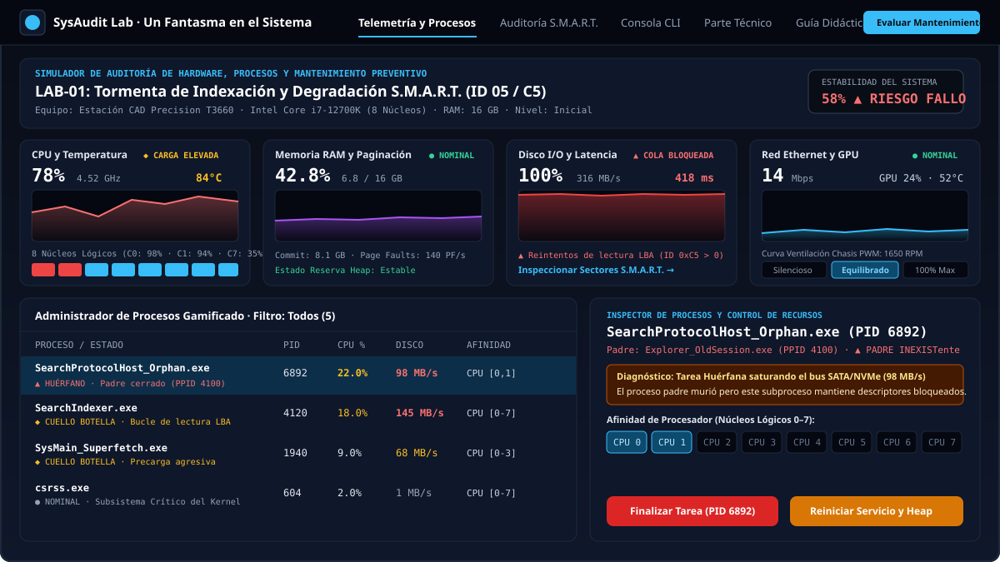
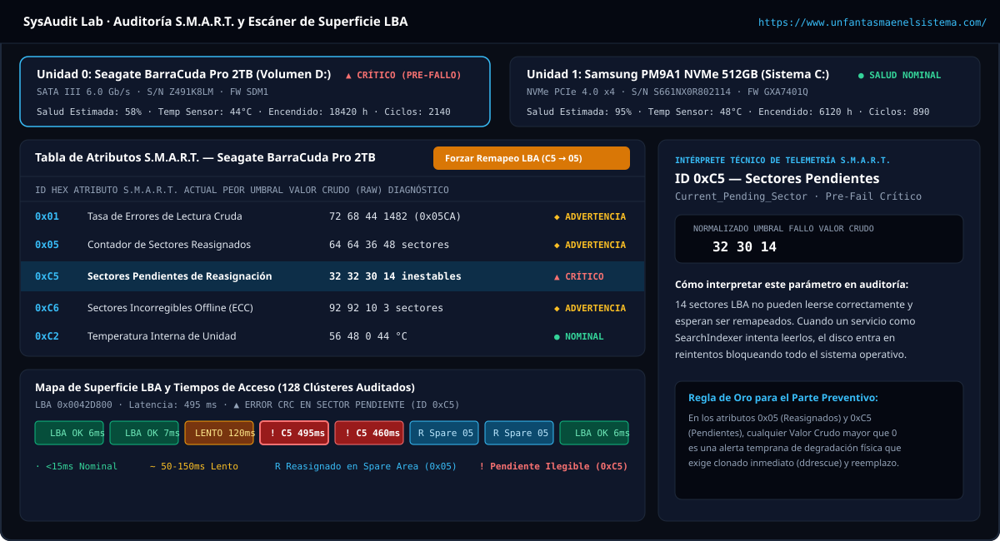
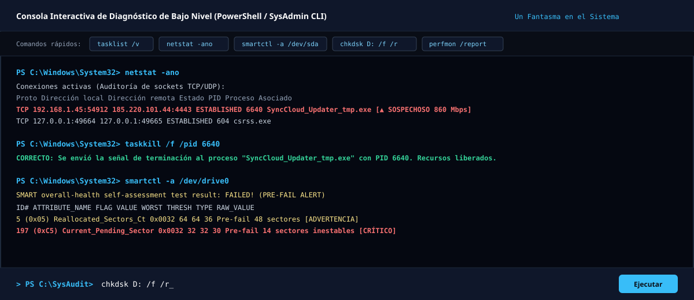
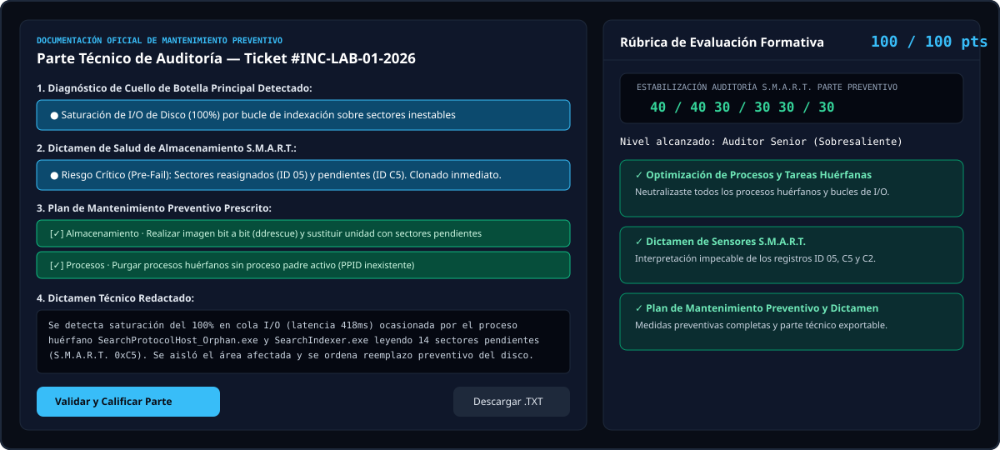

<div align="center">
  <a href="https://www.unfantasmaenelsistema.com/" target="_blank">
    
  </a>

  # SysAudit Lab — Analizador Interactivo de Auditoría, Chequeo S.M.A.R.T. y Optimizador de Rendimiento

  **Administrador de Tareas Gamificado y Laboratorio de Mantenimiento Preventivo**  
  Un recurso educativo de **[Un Fantasma en el Sistema](https://www.unfantasmaenelsistema.com/)**

  [](https://www.unfantasmaenelsistema.com/)
  [](https://react.dev/)
  [](https://www.typescriptlang.org/)
  [](https://pages.github.com/)
</div>

---

## 🎯 Propósito Educativo y Mecánica Didáctica

**SysAudit Lab** es un simulador técnico interactivo diseñado para ciclos formativos de informática (**SMR, ASIR, DAM, DAW** y cursos de soporte y mantenimiento de hardware/sistemas).

Su objetivo es entrenar al alumnado para:
1. **Interpretar telemetría en tiempo real** antes de que ocurra el fallo catastrófico del hardware (*Thermal Throttling*, *Pagefile Thrashing*, latencia de cola I/O o exfiltración de red).
2. **Auditar sensores S.M.A.R.T. a nivel hexadecimal y crudo (*Raw Values*)**, comprendiendo por qué atributos como `0x05` (*Reallocated Sectors Count*) o `0xC5` (*Current Pending Sector Count*) revelan degradación física mucho antes de que el estado básico del sistema avise de un error.
3. **Intervenir con criterio en el Administrador de Procesos**, distinguiendo entre **procesos críticos del kernel** (`csrss.exe`, `ntoskrnl.exe`), **procesos huérfanos (*Orphan Processes*)** cuyo proceso padre (`PPID`) ya murió, **servicios con fuga de memoria (*Memory Leaks*)** y cargas con **Prioridad `Tiempo Real`** o **Afinidad de CPU desbalanceada** en los núcleos `CPU 0` y `CPU 1`.
4. **Redactar el Parte Técnico de Mantenimiento Preventivo**, justificando las medidas correctivas y recibiendo una evaluación automática mediante rúbrica sobre 100 puntos.

---

## 📸 Capturas de Pantalla de la Aplicación

### 1. Cuadro de Mandos de Telemetría y Optimizador de Procesos (Afinidad de 8 Núcleos y Prioridad)


### 2. Auditoría S.M.A.R.T. Hexadecimal y Escáner de Superficie de Bloques LBA


### 3. Consola Interactiva de Diagnóstico de Bajo Nivel (PowerShell / SysAdmin CLI)


### 4. Parte Técnico de Mantenimiento Preventivo y Evaluación por Rúbrica (100 Puntos)


---

## 🧪 Escenarios de Laboratorio Incluidos

| Código | Escenario Clínico | Nivel | Patología Principal | Intervención Técnica Esperada |
| :--- | :--- | :--- | :--- | :--- |
| **LAB-01** | **Tormenta de Indexación y Degradación S.M.A.R.T. (ID 05 / C5)** | Inicial | Disco al 100% de actividad y latencia >400ms por reintentos de lectura sobre 14 sectores pendientes (`0xC5`). | Finalizar proceso huérfano `SearchProtocolHost_Orphan.exe`, reiniciar/bajar prioridad de `SearchIndexer.exe`, remapear sectores LBA y prescribir clonado con `ddrescue`. |
| **LAB-02** | **Fuga de Memoria (*Memory Leak*) y *Thrashing* de Paginación** | Intermedio | RAM al 96%, crecimiento del *Heap* a `+42 MB/s` y saturación de escrituras en `pagefile.sys` desgastando el SSD (`0xE7`). | Finalizar renderizador huérfano (`ChromeRender_Orphan.exe`), reiniciar servicio `TelemetryAgentSvc.exe` para vaciar el *Heap* y prescribir parcheo. |
| **LAB-03** | ***Thermal Throttling* (96°C) y Afinidad de CPU Mal Configurada** | Avanzado | Proceso pesado fijado en prioridad `Tiempo Real` sólo en `CPU 0` y `CPU 1`, ahogando el kernel y reduciendo el reloj a 2.1 GHz. | Repartir la **Afinidad de CPU** a los 8 núcleos (`0–7`), normalizar prioridad a `Normal`, eliminar tarea huérfana y subir la curva PWM de ventilación al `100%`. |
| **LAB-04** | **Exfiltración de Red Anómala y Proceso GPU Huérfano** | Intermedio | Tráfico saliente de 860 Mbps desde binario temporal no firmado (`AppData\Local\Temp`) y GPU al 88% / 89°C por proceso colgado. | Auditar sockets con `netstat -ano`, finalizar el ejecutable no firmado `SyncCloud_Updater_tmp.exe` y matar `ShaderCompiler_Orphan.exe`. |
| **EXAM-05** | **Auditoría Integral Multi-Fallo (Modo Certificación)** | Certificación | Crisis simultánea: fuga de RAM + contención en `CPU 0` + sectores pendientes S.M.A.R.T. + alerta térmica. | Priorizar intervenciones para recuperar la estabilidad por encima del 85% y redactar el informe completo de certificación. |

---

## 💻 Comandos Soportados en la Consola CLI Integrada

El simulador incorpora una terminal interactiva (`Consola CLI`) conectada en vivo al estado del sistema:

* `help` — Muestra la lista de comandos de auditoría disponibles.
* `tasklist /v` o `ps aux` — Vuelca la tabla completa de procesos con `PID`, `PPID`, estado del nodo padre, CPU%, RAM y prioridad.
* `taskkill /f /pid <PID>` — Termina forzosamente un proceso por su identificador `PID` (incluye protección didáctica del kernel ante procesos críticos como `csrss.exe`).
* `netstat -ano` — Lista las conexiones TCP/UDP activas, direcciones IP remotas y el `PID` responsable del consumo de ancho de banda.
* `wmic diskdrive get status` — Muestra la consulta básica WMI y explica por qué puede devolver `OK` aun existiendo sectores reasignados iniciales.
* `smartctl -a /dev/drive0` — Muestra el informe hexadecimal S.M.A.R.T. detallado con valores `VALUE`, `WORST`, `THRESH`, `TYPE` y `RAW_VALUE`.
* `chkdsk D: /f /r` — Ejecuta el examen de superficie NTFS y aísla los sectores pendientes (`0xC5`) en el área de reserva (`0x05`).
* `perfmon /report` — Genera un diagnóstico instantáneo de estabilidad, *Thermal Throttling*, *Page Faults/s* y latencia de disco.

---

## 🚀 Instalación Local y Despliegue en GitHub Pages

### 1. Ejecución en entorno local

```bash
# 1. Clonar el repositorio
git clone https://github.com/tu-usuario/sysaudit-lab.git
cd sysaudit-lab

# 2. Instalar dependencias
npm install

# 3. Iniciar servidor de desarrollo (http://localhost:3000)
npm run dev

# 4. Compilar para producción en la carpeta ./dist
npm run build
```

### 2. Publicación automática en GitHub Pages (Incluida)

El proyecto ya incluye configuración de rutas relativas (`base: './'` en `vite.config.ts`) y el flujo de trabajo oficial en `.github/workflows/deploy.yml`:

1. Sube este repositorio a tu cuenta de GitHub (`git push origin main`).
2. En tu repositorio de GitHub, entra en **Settings** → **Pages**.
3. En la sección **Build and deployment** → **Source**, selecciona **GitHub Actions**.
4. El workflow **Desplegar SysAudit Lab en GitHub Pages** compilará y publicará automáticamente la aplicación en `https://<tu-usuario>.github.io/<nombre-repo>/`.

---

## 🔗 Autoría y Créditos

Desarrollado para **[Un Fantasma en el Sistema](https://www.unfantasmaenelsistema.com/)**.  
Recursos educativos abiertos sobre hardware, sistemas operativos, ciberseguridad y administración de sistemas.
